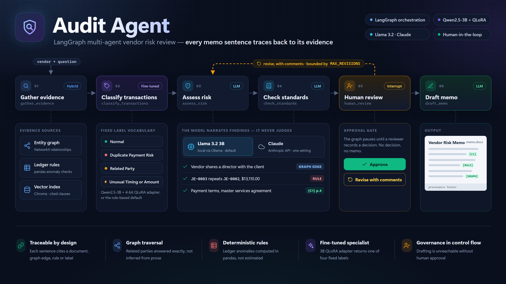
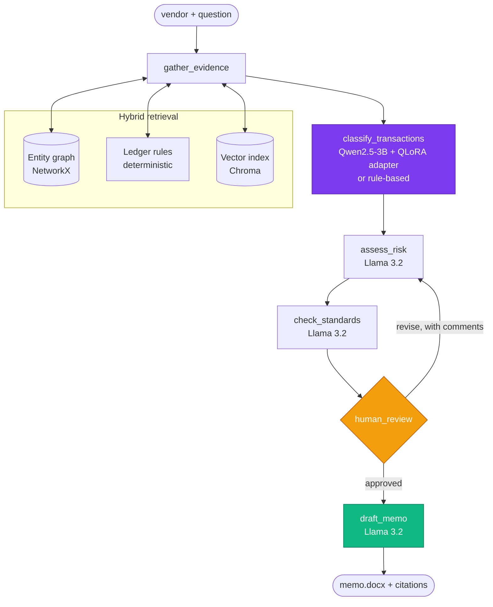

# Audit Agent — LangGraph multi-agent auditor with local Llama 3.2 and a QLoRA-fine-tuned Qwen2.5 classifier



A multi-agent system that reviews vendor risk on an audit engagement. It gathers
evidence from contracts and ledgers, reasons over an entity graph, labels every
transaction with a **Qwen2.5-3B-Instruct model fine-tuned with 4-bit QLoRA**, and
drafts a risk memo with **Llama 3.2 running locally through Ollama** (or
**Claude** via the Anthropic API, switchable with one setting), but only after a
human approves the findings.

The interesting problem here isn't generation. It's **traceability**: every
sentence in the final memo has to trace back to a document citation, a graph
edge, a deterministic rule, or a fixed classifier label. That constraint drives
most of the design below.

[](https://www.python.org/downloads/)
[](LICENSE)
[](https://github.com/langchain-ai/langgraph)
[](#switching-the-llm-llama-default-or-anthropic)
[](https://huggingface.co/Qwen/Qwen2.5-3B-Instruct)
[](https://github.com/astral-sh/ruff)

---

## What it does

Given a vendor name, the system:

1. **Traverses an entity graph** to check whether the vendor shares a director
   with the client. This is a relationship question, so it's answered by graph
   traversal rather than by asking a model to infer it from prose.
2. **Runs deterministic ledger rules** for duplicate payments, round-dollar
   amounts, and weekend postings. Exactly computable things are computed, not
   estimated.
3. **Retrieves supporting clauses** from contracts and accounting policy through
   vector search, carrying source and page metadata for citation.
4. **Classifies each transaction** into a fixed category vocabulary, using either
   deterministic rules or a **QLoRA-fine-tuned Qwen2.5-3B** specialist you train
   locally, so downstream systems parse stable labels instead of free prose.
5. **Pauses for human review.** The graph interrupts and waits. A reviewer
   approves, or sends it back with comments that feed into the next pass.
6. **Drafts the memo** with Llama 3.2 from approved findings and writes a `.docx`
   carrying its own provenance footer.

## Models

| Role | Model | Where it runs |
|---|---|---|
| Narrative, standards review, memo drafting, tool-use routing | **Llama 3.2 3B** via Ollama (default) or Claude via the Anthropic API (optional) | Local GPU/CPU, or hosted |
| Transaction risk classification | **Qwen2.5-3B-Instruct + LoRA adapter**, trained with 4-bit QLoRA (or the rule-based default) | Local CUDA GPU |
| Embeddings | `all-MiniLM-L6-v2` (sentence-transformers) | Local |

No trained weights are committed to this repository. The QLoRA adapter is
produced on your machine by one command (see
[Fine-tune the classifier](#fine-tune-the-classifier-qlora-on-qwen25-3b)).

## Architecture



Each node reads shared state and returns only the keys it changes; LangGraph
merges the updates and checkpoints them per thread, which is what lets a paused
review resume later.

## Design decisions

| Decision | Rationale |
|---|---|
| Graph traversal for related parties | "Does this vendor share a director?" is a traversal with an exact answer. Vector similarity would only find text that *sounds* related. |
| Rules for ledger anomalies | Duplicate detection is arithmetic. Running it as pandas gives reproducible findings and feeds the model grounded facts instead of a table to eyeball. |
| Fine-tuned specialist for classification | A narrow, high-volume labelling task is where fine-tuning beats prompting: a 3B QLoRA adapter returns exactly one of four labels, cheaply, every time. |
| Train and serve on the same text | One function, `describe_transaction`, renders both the training examples and the live ledger rows, so the adapter never sees a format it wasn't trained on. |
| Model narrates, never judges | Prompts instruct the model to summarise supplied findings only. Risk determinations come from rules, the graph and the classifier; the model supplies prose. |
| Interrupt-based approval gate | The workflow cannot reach drafting without a recorded decision in state: governance enforced by control flow, not by convention. |
| Bounded revision loop | A reviewer can send work back, but `MAX_REVISIONS` stops the graph cycling forever. |
| Providers behind a protocol | Nodes depend on an `LLMProvider` protocol, so local Llama and hosted Claude are interchangeable and tests inject a stub. |
| Classifiers behind a protocol | Rule-based and QLoRA classifiers share `TransactionClassifier`; one setting switches them. |
| Retrieval behind a protocol | `SearchIndex` keeps Chroma out of the unit tests, so the suite runs in seconds without a vector database. |

## Quickstart

```bash
git clone https://github.com/rezatorabi13/Audit-agent.git
cd Audit-agent

python -m venv .venv && source .venv/bin/activate   # Windows: .venv\Scripts\activate
pip install -r requirements.txt                     # everything, including QLoRA

cp .env.example .env      # optional: defaults are local Llama + rule-based classifier
```

Install [Ollama](https://ollama.com) and pull the default model:

```bash
ollama pull llama3.2:3b
```

Run everything from the repository root, so `audit_agent` resolves on the path.

Generate the synthetic corpus and build the vector index (once):

```bash
python examples/00_setup_corpus.py
```

Then run the demos:

```bash
python examples/01_grounded_qa.py          # grounded Q&A, citations, groundedness check
python examples/02_vendor_review.py        # full review incl. the revision loop
python examples/03_vendor_review_qlora.py  # review with the fine-tuned Qwen classifier
```

`01` also demonstrates the agentic path, where the model decides for itself
whether a question needs document retrieval: it retrieves for *"what does the
Globex contract say about termination?"* and answers *"what is 15% of 200?"*
directly. This uses Ollama's native tool calling with Llama 3.2, or Claude's
tool use when the Anthropic provider is selected.

### Switching the LLM: Llama (default) or Anthropic

| Provider | Setting | Needs |
|---|---|---|
| Llama 3.2 via Ollama | `AUDIT_LLM_PROVIDER=ollama` (default) | Ollama running, `ollama pull llama3.2:3b` |
| Claude via Anthropic | `AUDIT_LLM_PROVIDER=anthropic` | `ANTHROPIC_API_KEY` in `.env` |

Set these in `.env`, or per command:

```bash
AUDIT_LLM_PROVIDER=anthropic python examples/02_vendor_review.py      # bash
$env:AUDIT_LLM_PROVIDER="anthropic"; python examples/02_vendor_review.py   # PowerShell
```

The LLM choice is independent of the classifier: any provider works with either
the rule-based or the QLoRA classifier.

## Fine-tune the classifier (QLoRA on Qwen2.5-3B)

`finetuning/` fine-tunes **Qwen2.5-3B-Instruct** with **4-bit QLoRA** (NF4
quantisation, LoRA rank 8 on the attention projections, loss on label tokens
only) to classify transactions as `Normal`, `Duplicate Payment Risk`,
`Related Party`, or `Unusual Timing or Amount`.

**1. Check your GPU.** You need an NVIDIA GPU with ~8 GB VRAM (developed on an
RTX 4070). `requirements.txt` pulls a CUDA build of PyTorch; confirm it:

```bash
python -c "import torch; print(torch.__version__, torch.cuda.is_available())"
```

If this prints `False` on a machine with an NVIDIA GPU, reinstall torch from the
CUDA index and check again:

```bash
pip install --force-reinstall torch --index-url https://download.pytorch.org/whl/cu128
```

**2. Train.** This downloads the base model from Hugging Face (Apache-2.0,
ungated), reports accuracy before and after training on a held-out split, and
writes the adapter:

```bash
python -m finetuning.train_qlora
```

| Output | Path |
|---|---|
| LoRA adapter (loaded by the workflow) | `data/models/qwen_risk_classifier/adapter/` |
| Before/after metrics | `data/models/qwen_risk_classifier/metrics.json` |

`data/models/` is git-ignored: trained weights stay on your machine. The script
unloads the Ollama model first so the two don't compete for VRAM (`--keep-ollama`
to skip). Other flags: `--epochs`, `--lora-rank`, `--examples-per-class`,
`--seed`, `--output-dir`, `--base-model`.

**3. Use it in the agent:**

```bash
python examples/03_vendor_review_qlora.py
# or, for any entry point:
AUDIT_CLASSIFIER=qlora python examples/02_vendor_review.py
```

At inference time the 4-bit Qwen adapter and Llama 3.2 3B fit together in 8 GB.
If the adapter hasn't been trained yet, the workflow stops immediately with the
command to train it. See [`finetuning/README.md`](finetuning/README.md) for
details.

## Driving the workflow from your own code

`start()` and `resume()` are two separate calls because the graph pauses at the
review gate and checkpoints its state; the approval can arrive much later, from
a different request or process.

```python
from audit_agent.pipeline import build_workflow
from audit_agent.workflow import ReviewDecision

workflow = build_workflow()   # LLM and classifier come from settings / .env

pending = workflow.start(
    vendor="Acme Industrial Supplies Ltd.",
    question="Assess payment and related-party risk.",
)
print(pending.risk_findings)        # graph pauses here

result = workflow.resume(pending.thread_id, ReviewDecision.APPROVED)
print(result["memo"])
```

To force the fine-tuned classifier in code:

```python
from audit_agent.config import get_settings
from audit_agent.pipeline import build_workflow

settings = get_settings().model_copy(update={"classifier": "qlora"})
workflow = build_workflow(settings)
```

## Project layout

```
audit_agent/
├── config.py            # typed settings (pydantic-settings)
├── models.py            # domain objects: chunks, flags, evidence bundles
├── pipeline.py          # composition root: wires LLM, classifier, retrieval from settings
├── qa.py                # grounded Q&A + tool-use agent
├── ingestion/           # PDF/DOCX loading, citation-preserving chunking
├── retrieval/           # SearchIndex protocol, Chroma store, hybrid retriever
├── knowledge/           # entity graph, deterministic ledger rules
├── llm/                 # provider protocol, Ollama (Llama) + Anthropic backends
├── workflow/            # LangGraph state, nodes, graph, prompts, classifier protocol
├── evaluation/          # groundedness checking
├── reporting/           # memo rendering
└── data/                # synthetic corpus generation
finetuning/              # QLoRA fine-tuning of Qwen2.5-3B + the LoRAClassifier
├── dataset.py           # seeded synthetic training data
├── train_qlora.py       # training script -> data/models/qwen_risk_classifier/adapter
└── classifier.py        # loads the adapter, implements TransactionClassifier
examples/                # setup + three runnable end-to-end demos
tests/                   # runs without a GPU, API key, Ollama, or vector database
```

## Testing

```bash
pytest                       # unit suite, no GPU, API key or network needed
pytest --cov=audit_agent     # with coverage
```

The suite covers the parts where correctness is checkable: ledger rules, graph
traversal, chunk citation metadata, the review gate, revision routing, tool-use
branching for both providers, classifier selection, label snapping, and the
train/serve description format. LLM providers, the vector index and the QLoRA
model are stubbed behind their protocols.

## Governance mapping

The design maps onto the four functions of the [NIST AI Risk Management
Framework](https://www.nist.gov/itl/ai-risk-management-framework):

| Function | Implementation |
|---|---|
| **Govern** | The approval gate: no memo is produced without a recorded human decision, and the decision is written into the deliverable. |
| **Map** | Each reasoning type is routed to the appropriate tool: traversal to the graph, arithmetic to rules, labelling to a fine-tuned specialist, language to the general model. |
| **Measure** | Before/after accuracy of the fine-tuned classifier on a held-out split; groundedness checking on generated output; a test suite pinning rule and traversal behaviour. |
| **Manage** | Locally trained, git-ignored adapters with recorded metrics; thread-scoped checkpointing so paused reviews resume; bounded revision loops; citations carried into the deliverable. |

## Data disclaimer

All data in this repository is synthetic and generated by
`audit_agent.data.synthetic` and `finetuning.dataset`. The client, vendors,
people, and transactions are fictional. Anomalies are planted deliberately (a
duplicate invoice, a round-dollar weekend posting, an undisclosed shared
director) so retrieval and rule coverage can be verified against a known ground
truth.

This is a demonstration of an audit-support system.

## License

MIT — see [LICENSE](LICENSE). Base models keep their own licenses:
Qwen2.5-3B-Instruct (Apache-2.0) and Llama 3.2 (Llama 3.2 Community License).
