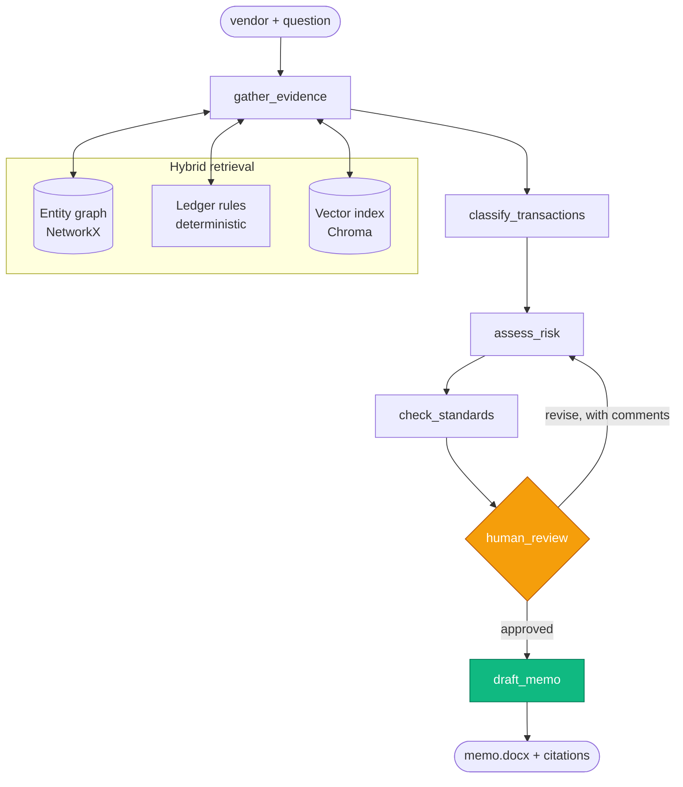

# Audit Agent

A multi-agent system that reviews vendor risk on an audit engagement: it gathers
evidence from contracts and ledgers, reasons over an entity graph, and drafts a
risk memo — but only after a human approves the findings.

The interesting problem here isn't generation. It's **traceability**: every
sentence in the final memo has to trace back to a document citation, a graph
edge, or a deterministic rule. That constraint drives most of the design below.

[](https://www.python.org/downloads/)
[](LICENSE)
[](https://github.com/astral-sh/ruff)

---

## What it does

Given a vendor name, the system:

1. **Traverses an entity graph** to check whether the vendor shares a director
   with the client — a relationship question, answered by graph traversal rather
   than by asking a model to infer it from prose.
2. **Runs deterministic ledger rules** for duplicate payments, round-dollar
   amounts, and weekend postings. Exactly computable things are computed, not
   estimated.
3. **Retrieves supporting clauses** from contracts and accounting policy through
   vector search, carrying source and page metadata for citation.
4. **Classifies each transaction** into a fixed category vocabulary, so
   downstream systems parse stable labels instead of free prose.
5. **Pauses for human review.** The graph interrupts and waits. A reviewer
   approves, or sends it back with comments that feed into the next pass.
6. **Drafts the memo** from approved findings and writes a `.docx` carrying its
   own provenance footer.

## Architecture



Each node reads shared state and returns only the keys it changes; LangGraph
merges the updates and checkpoints them per thread, which is what lets a paused
review resume later.

## Design decisions

| Decision | Rationale |
|---|---|
| Graph traversal for related parties | "Does this vendor share a director?" is a traversal with an exact answer. Vector similarity would only find text that *sounds* related. |
| Rules for ledger anomalies | Duplicate detection is arithmetic. Running it as pandas gives reproducible findings and feeds the model grounded facts instead of a table to eyeball. |
| Model narrates, never judges | Prompts instruct the model to summarise supplied findings only. Risk determinations come from rules and the graph; the model supplies prose. |
| Interrupt-based approval gate | The workflow physically cannot reach drafting without a recorded decision in state — governance enforced by control flow, not by convention. |
| Bounded revision loop | A reviewer can send work back, but `MAX_REVISIONS` stops the graph cycling forever. |
| Providers behind a protocol | Nodes depend on an `LLMProvider` protocol, so hosted Claude and local Ollama are interchangeable and tests inject a stub. |
| Retrieval behind a protocol | `SearchIndex` keeps Chroma out of the unit tests, so the suite runs in seconds without a vector database. |
| Constructor injection everywhere | The original prototype reached for module globals. Dependencies now arrive via `WorkflowDependencies`, which is why the graph is testable at all. |

## Quickstart

```bash
git clone https://github.com/rezatorabi/Audit-agent.git
cd Audit-agent

python -m venv .venv && source .venv/bin/activate   # Windows: .venv\Scripts\activate
pip install -r requirements.txt

cp .env.example .env    # add your ANTHROPIC_API_KEY
```

Run everything from the repository root, so `audit_agent` resolves on the path.

Generate the synthetic corpus and build the vector index (once):

```bash
python examples/00_setup_corpus.py
```

Then run either demo:

```bash
python examples/01_grounded_qa.py     # grounded Q&A, citations, groundedness check
python examples/02_vendor_review.py   # full review incl. the revision loop
```

`01` also demonstrates the agentic path, where the model decides for itself
whether a question needs document retrieval — it retrieves for *"what does the
Globex contract say about termination?"* and answers *"what is 15% of 200?"*
directly.

### Running fully locally

No API key, no data leaving the machine — requires [Ollama](https://ollama.com):

```bash
ollama pull llama3.2:3b
AUDIT_LLM_PROVIDER=ollama python examples/02_vendor_review.py
```

Tool-use routing is Anthropic-only; the local provider raises a clear error
rather than silently degrading.

## Driving the workflow from your own code

`start()` and `resume()` are two separate calls because the graph pauses at the
review gate and checkpoints its state — the approval can arrive much later, from
a different request or process.

```python
from audit_agent.pipeline import build_workflow
from audit_agent.workflow import ReviewDecision

workflow = build_workflow()

pending = workflow.start(
    vendor="Acme Industrial Supplies Ltd.",
    question="Assess payment and related-party risk.",
)
print(pending.risk_findings)        # graph pauses here

result = workflow.resume(pending.thread_id, ReviewDecision.APPROVED)
print(result["memo"])
```

## Project layout

```
audit_agent/
├── config.py            # typed settings (pydantic-settings)
├── models.py            # domain objects: chunks, flags, evidence bundles
├── pipeline.py          # composition root — wires everything from settings
├── qa.py                # grounded Q&A + tool-use agent
├── ingestion/           # PDF/DOCX loading, citation-preserving chunking
├── retrieval/           # SearchIndex protocol, Chroma store, hybrid retriever
├── knowledge/           # entity graph, deterministic ledger rules
├── llm/                 # provider protocol, Anthropic + Ollama backends
├── workflow/            # LangGraph state, nodes, graph, prompts, classifier
├── evaluation/          # groundedness checking
├── reporting/           # memo rendering
└── data/                # synthetic corpus generation
examples/                # setup + two runnable end-to-end demos
finetuning/              # optional QLoRA specialist classifier (GPU only)
tests/                   # runs without an API key or vector database
```

## Testing

```bash
pytest                       # unit suite, no API key or network needed
pytest --cov=audit_agent     # with coverage
```

The suite covers the parts where correctness is checkable: ledger rules, graph
traversal, chunk citation metadata, the review gate, revision routing, and
tool-use branching. LLM providers and the vector index are stubbed behind their
protocols.

## Optional: fine-tuned classifier

`finetuning/` trains a 4-bit QLoRA adapter on Qwen2.5-3B-Instruct to classify
transactions into the fixed category vocabulary — cheaper and more format-stable
at volume than prompting a general model per transaction.

It implements the same `TransactionClassifier` protocol as the default rule-based
labeller, so it drops into the workflow without changing a node:

```python
from audit_agent.pipeline import build_workflow
from finetuning.classifier import LoRAClassifier

workflow = build_workflow(classifier=LoRAClassifier("data/models/adapter"))
```

Requires a CUDA GPU with ~8GB VRAM. See [`finetuning/README.md`](finetuning/README.md).

## Governance mapping

The design maps onto the four functions of the [NIST AI Risk Management
Framework](https://www.nist.gov/itl/ai-risk-management-framework):

| Function | Implementation |
|---|---|
| **Govern** | The approval gate: no memo is produced without a recorded human decision, and the decision is written into the deliverable. |
| **Map** | Each reasoning type is routed to the appropriate tool — traversal to the graph, arithmetic to rules, language to the model. |
| **Measure** | Groundedness checking on generated output; a test suite pinning rule and traversal behaviour. |
| **Manage** | Thread-scoped checkpointing so paused reviews resume; bounded revision loops; citations carried into the deliverable. |

## Data disclaimer

All data in this repository is synthetic and generated by
`audit_agent.data.synthetic`. The client, vendors, people, and transactions are
fictional. Anomalies are planted deliberately (a duplicate invoice, a
round-dollar weekend posting, an undisclosed shared director) so retrieval and
rule coverage can be verified against a known ground truth.

This is a demonstration of an audit-support system.

## License

MIT — see [LICENSE](LICENSE).
